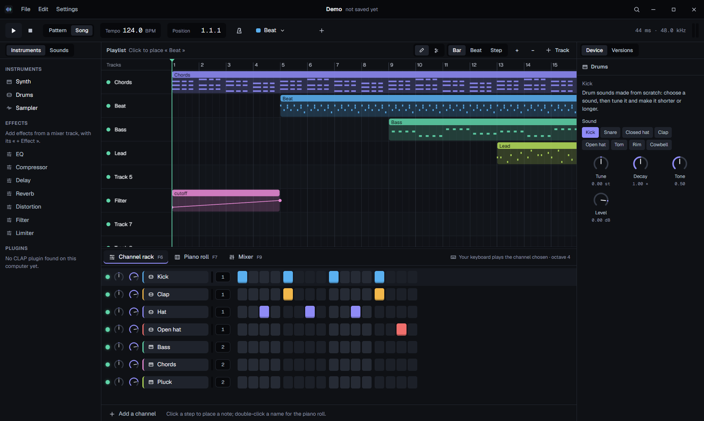

# Sonevo

A free and open source music studio: patterns, a step sequencer, a piano roll, a playlist
and a mixer, Sonevo's own instruments and effects, and the plugins already on your computer.



## What it does

- **Make a beat in seconds**: the channel rack's steps, a click each; drums synthesized from
  scratch, a synth, a sampler; your computer keyboard as a piano.
- **Write melodies**: a piano roll that lights the scale you choose, with velocity, copy and
  paste, and the other channels' notes faintly behind.
- **Arrange**: patterns, sounds and automation placed, stretched and cut in the playlist; a
  loop set on the ruler; a pattern played alone, or the whole song.
- **Mix**: mixer tracks with effects (EQ, compressor, delay, reverb, distortion, filter,
  limiter), sends, mute and solo, and any setting automated with a right-click.
- **Your plugins**: the CLAP plugins installed, each played in a process of its own: one that
  crashes is started again, its notes held pressed again, and the song plays on.
- **An open format**: a song is a folder of plain files, a pattern's notes one a line,
  its sounds beside them named by what is in them; a change shows as a small diff.
- **Versions of a song**: every save kept, the ones that matter named, any of them listened
  to in place of the song, or brought back.
- **Nothing lost**: the song kept as it changes, offered back after a crash.
- **Export**: the song, its loop, or each mixer track alone, to WAV.

Every device explains itself in a sentence: Sonevo is meant for those who have never made
music too. English and French.

Windows first (WASAPI and ASIO), macOS and Linux after.

## Building

You need Rust (the version in `rust-toolchain.toml`), Node 24 and pnpm.

```
cd frontend && pnpm install && cd ..
cargo build -p sonevo-plugin-host
cd apps/sonevo-desktop && ../../frontend/node_modules/.bin/tauri dev
```

ASIO needs libclang to build: `pip install --target .tools/libclang libclang==18.1.1`.

The installer: `tauri build --config tauri.release.conf.json` from `apps/sonevo-desktop`.

## The parts

| Folder | What it is |
| --- | --- |
| `crates/sonevo-project` | A song: its model, its edits and their undo, the folder it is saved as |
| `crates/sonevo-dsp` | Sonevo's own instruments and effects |
| `crates/sonevo-engine` | The real-time engine: a song compiled into a graph the audio thread swaps in, played live or to a file, never allocating on the audio thread |
| `crates/sonevo-audio` | The sound card, WASAPI or ASIO |
| `crates/sonevo-plugins` | The CLAP plugins found, and each played in a process of its own |
| `crates/sonevo-clap`, `crates/sonevo-plugin-ipc`, `apps/plugin-host` | CLAP hosting, and the link between the engine and a plugin's process |
| `crates/sonevo-versions` | A song's versions, in a git repository of its own written by gitoxide |
| `apps/sonevo-desktop` | The application (Tauri v2) |
| `frontend` | Its interface (Angular; the piano roll and the playlist drawn with PixiJS) |

The road ahead is in [docs/ROADMAP.md](docs/ROADMAP.md); the engine's first measures in
[docs/spikes/engine.md](docs/spikes/engine.md).

## Licence

GPL-3.0-or-later.
